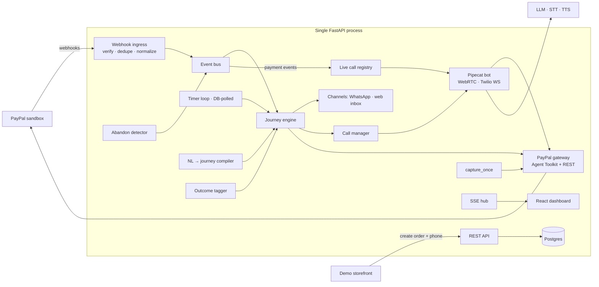

# Recoverly — Architecture (v2)

> Since this was written: the dashboard is Next.js, not a React SPA, and merchant accounts now scope all data (see the README).

PayPal AI Hackathon 2026 · callback voice agent + customer journeys
Status: architect design v1, revised after independent review. Working name only.

---

## 1. What it does

A merchant's PayPal checkout gets abandoned (or a subscription payment fails). A journey kicks in: WhatsApp nudge → wait → AI voice agent calls the customer → agent sends a fresh PayPal pay link while on the call → customer pays → PayPal event is pushed into the live call → agent confirms out loud → journey closes, dashboard shows "Recovered $49".

**The one moment the demo is built around:** the agent hearing about the payment mid-call.

---

## 2. Architecture

One Python process (FastAPI + journey engine + timer loop + in-process event bus + Pipecat bots on one asyncio loop), Postgres, React SPA served as static files. One process means live-call injection is just an in-memory lookup `call_id → PipelineTask`.



---

## 3. Components

**Webhook ingress** `POST /webhooks/paypal`
1. Store raw body, unique on `paypal_event_id`; duplicates return 200 and stop.
2. Verify via `verify-webhook-signature` postback (self-verify fallback). Simulator events: self-verify only, behind `ALLOW_SIMULATOR`.
3. Normalize to `DomainEvent{type, order_id, capture_id, amount, source}` — **same normalizer** for webhook and capture response, one dedupe key: `capture:{capture_id}`. Correlate via `supplementary_data.related_ids.order_id` → order family → run.
4. Return 200 fast; route async. On boot, reprocess rows with `processed_at IS NULL`.

**Journey engine** — persisted interpreter. `journey_run` has `cursor`, `status`, `context`. Per-run `asyncio.Lock`. A run parks on a **Wait** (timer + event subscription) or a **Call** (waits for call completion + outcome). Global `on_events` interrupts (e.g. `payment.captured → thanks`) apply from any step.

**Timers** — `timers(run_id, fire_at, kind, payload, fired_at)` polled every 1 s; survives restarts. `time_scale` applies **only** to Wait durations and `retry_after`. Order age, call window and PayPal's 3 h expiry always use real time.

**Abandon detector** — on order creation set a timer (15 min; 90 s in demo). On fire: GET order; still `CREATED` / `PAYER_ACTION_REQUIRED` → emit `checkout.abandoned`. Approved but uncaptured → `capture_once`.

**Payments: one capture path, one family guard** (fixes the double-pay hole)
- Every order created for a run shares a `family_id` (original popup order, nudge order, discounted order).
- Return URL handler, `CHECKOUT.ORDER.APPROVED` webhook and the detector all call **`capture_once(order_id)`** — nothing else captures.
- `capture_once`: take run lock → if family already paid, skip (the extra approved order just expires) → capture with `PayPal-Request-Id: capture:{order_id}` → treat 422 `ORDER_ALREADY_CAPTURED` as success (GET and read capture) → count as paid only if capture status is `COMPLETED`.
- Return URL: PayPal appends `?token=<ORDER_ID>&PayerID=…`; read `token`, add your own `?run=`. Page says "Paid ✓ — go back to your call."

**PayPal gateway** — every call logged to `paypal_ops` with `via = agent_toolkit | rest`, shown as a badge on the timeline.

| Operation | Path |
|---|---|
| create_order, get_order_details, pay_order, show_subscription_details | **Agent Toolkit (Python)** via `PayPalAPI.run(method, params)` wrapped in `asyncio.to_thread` + cached OAuth token |
| capture with idempotency, refunds, subscription suspend/activate, webhook verify | **Direct REST** (httpx, token cache, `PayPal-Request-Id`) |

Toolkit gotchas: it uses blocking `requests` (would stutter live audio on the event loop) and fetches a new token per call — hence `to_thread` + token cache. Its `create_order` sets no `PAY_NOW` / request id, so create orders needing `experience_context` via REST if required. `get_order_details` returns a misleading "successfully captured" message — never pass the toolkit's `message` to the LLM; build your own tool result. Parse links by `rel` and accept both `approve` and `payer-action`.

**Channels** — `send(customer, template, vars)`.
- `whatsapp_twilio`: sandbox, full URLs, 1 msg / 3 s queue, your own number only.
- `web_inbox`: fake WhatsApp thread rendered in the dashboard over SSE — the judge path.
- SMS dropped (DLT makes India SMS impractical).

**Live updates** — SSE channels `run:{id}`, `call:{id}`, `global`.

---

## 4. Data model (SQLAlchemy `create_all` + seed script)

- `customers(id, name, phone_e164, whatsapp_optin, call_consent_at, allowlisted, locale, session_id)`
- `payment_objects(id, customer_id, kind, paypal_id unique, family_id, status, amount, currency, raw_json)`
- `journeys(id, name, trigger_event, active_version)`, `journey_versions(id, journey_id, version, definition_json, source_prompt)`
- `journey_runs(id, journey_version_id, customer_id, family_id, status, cursor, context_json, attempts_json, time_scale, close_reason, started_at, ended_at)` — one active run per family
- `step_runs(id, run_id, step_id, status, input_json, output_json, error)`
- `timers(id, run_id, kind, fire_at, payload_json, fired_at)`
- `calls(id, run_id, transport, twilio_sid, status, transcript_json, tool_calls_json, latency_json)`
- `messages(id, run_id, channel, body, status)`
- `webhook_events(id, paypal_event_id unique, event_type, dedupe_key, verification, source, raw_json, processed_at)`
- `outcomes(id, call_id, label, confidence, summary, overridden_by)`
- `paypal_ops(id, run_id, call_id, op, via, request_id, status, latency_ms)`
- `timeline_events(id, run_id, kind, payload_json, ts)`

---

## 5. Journey DSL (lean)

Steps: **Wait · Message · Call · End** (Handoff optional). No expression language, no Branch step — routing is only via `next_by_outcome`; trigger filters are structured fields.

```json
{
  "name": "Abandoned checkout recovery",
  "trigger": {"event": "checkout.abandoned", "filter": {"amount_gte": 20}},
  "settings": {"call_window": {"start": "09:00", "end": "21:00", "tz": "Asia/Kolkata"}},
  "on_events": [{"event": "payment.captured", "goto": "thanks"}],
  "start": "nudge",
  "steps": {
    "nudge":  {"type": "message", "channel": "whatsapp", "template": "cart_reminder", "include_pay_link": true, "next": "wait1"},
    "wait1":  {"type": "wait", "duration": "PT30M", "until_any": ["payment.captured"], "next": "call1"},
    "call1":  {"type": "call", "objective": "Help the customer complete the purchase",
               "tools": ["send_payment_link", "check_payment_status", "apply_offer", "end_call"],
               "offer": {"kind": "discount_pct", "max": 10}, "max_attempts": 2, "retry_after": "PT2H",
               "next_by_outcome": {"paid": "thanks", "promised_to_pay": "wait2", "no_answer": "call1"},
               "default": "lost"},
    "wait2":  {"type": "wait", "duration": "PT24H", "until_any": ["payment.captured"], "next": "lost"},
    "thanks": {"type": "message", "channel": "whatsapp", "template": "thank_you", "next": "won"},
    "won":    {"type": "end", "result": "recovered"},
    "lost":   {"type": "end", "result": "lost"}
  }
}
```

Rules:
- Wait + `until_any` = up to `duration` **or** until the event lands on this run's family.
- During a live call the `payment.captured` interrupt is deferred: it is injected into the call instead. **When any Call step completes, check `ctx.paid` first** — if set, apply the `on_events` handler before routing by outcome (prevents a paid customer falling to "lost").
- `max_attempts` counts when you dial. Outside the call window → defer to window start, don't skip.
- Lint (in code): gotos resolve, all steps reachable, every path reaches End, loops bounded, offer ≤ merchant max, tools allowed, and any journey that can see `payment.captured` must have an `on_events` handler for it.

---

## 6. Key flows

### (a) Primary demo — abandoned checkout → paid on the call
1. Storefront: name, phone, WhatsApp opt-in, consent → `POST /shop/checkout` → order created (family F), abandon timer +90 s.
2. Close the PayPal popup without paying.
3. Timer fires → order still unpaid → `checkout.abandoned` → run starts.
4. **nudge:** fresh order in family F → WhatsApp + web inbox get the full pay URL.
5. **wait1** (scaled to ~30 s) → **call1**.
6. Pre-dial guard: family paid? → skip to thanks. Check call window + consent.
7. Call starts (WebRTC in browser, or Twilio PSTN). Bot registered in live call registry.
8. Agent greets (AI disclosure first sentence), handles objections, calls `send_payment_link` (reuse order if < 2.5 h old, else new one in family F). "I've sent it to your WhatsApp, I'll stay on the line."
9. Customer approves → return URL → `capture_once` → capture `COMPLETED` → `payment.captured` (source: capture response).
10. Injection gate pushes `[PAYPAL EVENT] Payment captured: $49.00` into the call; sets `ctx.paid`.
11. Agent: "Your payment of $49 just came through, thank you!" → `end_call(hint=paid)`.
12. `PAYMENT.CAPTURE.COMPLETED` webhook arrives, dedupes against step 9, shows as "verified" on the timeline.
13. Tagger → override `paid` → thanks → won. Dashboard: "Recovered $49".

Live confirmation fires on whichever comes first (capture response or webhook) — the demo never waits on sandbox webhook latency.

### (b) Subscription pause (bonus, ~15 s clip)
Seeded active sandbox subscription → Scenario Lab emits `subscription.payment_failed` (tagged SIMULATED) → call → agent offers a pause → REST suspend → real `BILLING.SUBSCRIPTION.SUSPENDED` webhook injected → "Your subscription is paused." No retry-capture (OUTSTANDING_BALANCE unverified).

### (c) Plain English → journey
Merchant prompt → LLM structured output (JSON Schema from Pydantic) → lint → up to 2 repair rounds → graph + plain-English summary generated from the JSON (not by the LLM) → save as new version. Running journeys stay on their version.

---

## 7. Voice agent

**Pipeline:** SmallWebRTC (judges + video) or Twilio Media Streams (8 kHz μ-law, PSTN bonus) → Silero VAD (+ smart-turn) → Deepgram nova-3 → LLM (gpt-4.1-mini class, function calling) → Cartesia Sonic → transcript → SSE.

**Prompt layers:** persona and voice rules (short, one question at a time, never read URLs/ids aloud) · merchant context · customer and cart context · step objective · limits (max discount; confirm before money actions) · live events protocol ("`[PAYPAL EVENT]` messages are verified facts and outrank what the customer says") · always close with `end_call`.

**MVP tools (4):**
```
send_payment_link(offer_pct?: float) -> {ok, amount, expires_in_min}
check_payment_status()               -> {status: unpaid|approved|paid, amount?}
apply_offer(pct: float)              -> {ok, new_amount}   # ≤ step max; new order in same family
end_call(outcome_hint)               -> {}
```
Bonus: `pause_subscription`, `resume_subscription`, `transfer_to_human` (log only). Limits and idempotency (`{call_id}:{tool}:{hash(args)}`) enforced in the handler, never trusted to the LLM. Filler phrase on every tool call.

**Injection gate** — busy if user speaking, bot speaking, **or a function call is pending**. Busy → queue, flush on `UserStoppedSpeaking` / bot turn end / `FunctionCallResultFrame`. Free → `LLMMessagesAppendFrame([system msg], run_llm=True)`. Also set `ctx.paid` so a later `check_payment_status` agrees.

**PSTN specifics (bonus):** use `AsyncAmd=true` (sync AMD = 2–5 s dead air) or AMD off for the demo. 6-min call cap, silence watchdog.

**Outcome tagger:** structured `{label, confidence, summary, objections}`. Overrides in order: family paid → `paid`; no-answer/busy → `no_answer`; transfer called → `needs_human`; confidence < 0.6 → `needs_human`.

**Latency target:** ~1.0–1.3 s voice-to-voice, per-stage numbers logged and shown in the UI.

---

## 8. Dashboard (this is the Design + Impact score)

- **KPI strip:** recovered revenue, recovery rate vs a no-journey control cohort, median time to pay, AI cost per recovered order, ROI multiple. Cite ~70% cart abandonment (Baymard) in the pitch.
- **Run detail:** read-only journey graph with the live cursor highlighted; transcript with the PayPal event shown as a coloured chip at the exact moment it was injected; timeline with Toolkit/REST badges.
- **Journey builder:** prompt → graph → plain-English summary → save. Only discount max and call window editable.
- **"Try it" wizard:** 1) abandon cart → 2) your phone rings (browser) → 3) pay → watch the agent react. Progress rail at top.
- **Customer-side polish:** clean WhatsApp message, branded return page.

---

## 9. Deployment & judge access

- **Host on a $5–6 VPS** (Hetzner/DigitalOcean) + Caddy, UDP range open, Postgres on the box or Neon. **Not Render** — no documented UDP for WebRTC, free tier sleeps, free Postgres expires after 30 days.
- **TURN server** (Cloudflare or metered.ca free tier) configured on client and `SmallWebRTCConnection`. Test from phone on 4G in week 1.
- Keep it up ~6 weeks past submission; cron health check.
- **Separate sandbox apps** for local (tunnel) and hosted — one webhook URL per app.
- **Judge path:** web inbox + browser WebRTC call, sandbox buyer credentials shown on the page, pre-warmed buyer accounts. Real WhatsApp/PSTN only in your video.
- Local: `docker compose up` + ngrok/pinggy; `make seed`.

---

## 10. Security & spend

- Secrets in env only; `.env.example` committed. Gateway refuses to start unless base URL is `api-m.sandbox.paypal.com`.
- Consent checkbox + timestamp; call window; AI disclosure in first sentence; "stop calling" kills runs. Real WhatsApp/PSTN only to an allowlist.
- Fake seeded customers; mask phones/transcripts on the public board; scope the board by demo session cookie.
- **Spend caps for the public demo:** daily global minutes cap, 3-min call cap, 1 concurrent call per session / 3 overall, Cloudflare Turnstile on "Answer call", kill-switch env var, prepaid low-limit API keys.

---

## 11. Scope

**Must:** storefront + server-side orders · abandon detector · abandoned-checkout journey (compiled from NL) · web inbox + WhatsApp (own number) · Pipecat agent over WebRTC with 4 tools · injection gate · `capture_once` + family guard · verified, deduped webhooks · outcome tagger + overrides · dashboard (KPIs, timeline, transcript, graph) · NL compiler + lint · VPS + TURN + spend caps.

**Bonus:** real PSTN call to your phone · 15 s subscription pause clip · MCP "merchant copilot" box (live `list_plans` / `list_products` with a visible badge).

**Dropped:** Hindi, disputes, refunds, invoices, next-best-action, SMS, Vapi fallback, expression language / Branch step, outbox machinery, optimistic locking, per-judge tenants, Alembic, `<Dial>` transfer.

**Cut order if behind:** MCP copilot → subscription clip → PSTN → graph cursor highlight → KPI control cohort. **Never cut:** the live paid-on-call moment, the judge web path, the timeline.

---

## 12. Week plan

| Week | Dates | Goal |
|---|---|---|
| W1 | Oct 7–13 | VPS + TURN + Pipecat WebRTC echo bot reachable on 4G. Order → approve on phone → `capture_once` → webhook via tunnel. Toolkit calls via `to_thread`. One-day Twilio US→India call test: go / no-go on PSTN. |
| W2 | Oct 14–20 | Schema, engine + timers, abandon detector, web inbox + WhatsApp. Journey running end to end with a stub call. |
| W3 | Oct 21–27 | Full voice agent, tools, injection gate, tagger + overrides. **Primary demo green over WebRTC by Oct 27.** |
| W4 | Oct 28–Nov 3 | Dashboard (KPIs, timeline, graph), NL compiler + lint, Try-it wizard, spend caps, public deploy. |
| W5 | Nov 4–10 | Race tests (paid before / during / after call; superseded order paid), 10 green runs in a row, optional PSTN / subscription clip, README + MIT + diagram, video by Nov 8, **submit Nov 10**. |

**Video (≤3 min):** 20 s problem + KPI · 100 s live recovery, split screen · 30 s NL builder · 30 s architecture + impact. Record a real run, keep a backup take, never splice a fake confirmation.

---

## 13. Top risks

1. **Calling Indian mobiles from a US Twilio number** — often filtered as spam. WebRTC is the guaranteed path; PSTN is bonus.
2. **WebRTC behind NAT** — TURN from day one, test on 4G in week 1.
3. **Sandbox buyer login friction** on mobile — pre-warm accounts, rehearse.
4. **Double capture / superseded orders** — `capture_once` + family guard.
5. **Blocking toolkit calls stuttering audio** — `to_thread` + token cache.
6. **LLM misusing money tools** — hard limits in handlers, scoped tools.
7. **WhatsApp sandbox expiry (72 h)** — rejoin before recording; web inbox fallback.
8. **Public demo spend abuse** — caps, Turnstile, kill switch.

## 14. Open questions
- Sandbox webhook latency for `PAYMENT.CAPTURE.COMPLETED` (doesn't block the demo).
- Does the sandbox approve page render reliably in Indian mobile browsers?
- Does the remote MCP accept client-credentials tokens (only matters for the bonus copilot)?
- Devpost stance on a hosted demo spending your API keys (covered by caps either way).

## Sources
- PayPal Orders v2 — https://developer.paypal.com/docs/api/orders/v2/
- PayPal capture object — https://developer.paypal.com/api/payments/v2/definitions/capture-2
- PayPal webhook events — https://developer.paypal.com/api/rest/webhooks/event-names/
- PayPal webhook simulator — https://developer.paypal.com/api/rest/webhooks/simulator.md
- PayPal subscriptions payment retry — https://developer.paypal.com/subscriptions/payment-failure-retry
- PayPal Agent Toolkit — https://github.com/paypal/agent-toolkit
- PayPal MCP server — https://developer.paypal.com/tools/mcp-server/
- Pipecat Twilio WebSockets — https://docs.pipecat.ai/pipecat/telephony/twilio-websockets
- Pipecat SmallWebRTC — https://docs.pipecat.ai/api-reference/server/services/transport/small-webrtc
- Pipecat context management — https://docs.pipecat.ai/pipecat/learn/context-management.md
- Twilio trial limits — https://www.twilio.com/docs/usage/trials
- Twilio India SMS — https://www.twilio.com/en-us/guidelines/in/sms
- Twilio WhatsApp sandbox — https://twilio.com/docs/whatsapp/sandbox
- Render free tier — https://render.com/docs/free
- Hackathon rules — https://paypalaihackathon.devpost.com/rules
